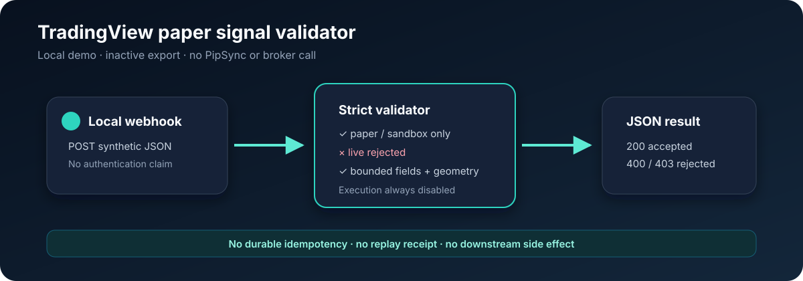

# PipSync n8n Templates

[](https://github.com/pipsyncio/pipsync-n8n-templates/actions/workflows/ci.yml)
[](LICENSE)
[](docs/security-boundaries.md)

Three importable n8n workflows for learning and read-only PipSync
integrations. Every export ships inactive, credential-free, synthetic, and
with all remote request and notification nodes disabled.

These templates do not place, modify, or close orders. They are not trading
signals, investment advice, or a promise of performance. Trading can result in
loss.

## Templates

| Workflow | Purpose | Remote behavior as shipped |
| --- | --- | --- |
| [TradingView paper validator](workflows/01-tradingview-paper-signal-validator.json) | Validate a small synthetic `paper`/`sandbox` JSON payload and return a bounded result | None |
| [Read-only signals to chat](workflows/02-read-only-signals-to-chat.json) | Summarize `GET /signals` without sending identifiers, prices, channel names, or provider names to chat | GET and chat nodes disabled |
| [Usage, health, and report alert](workflows/03-read-only-usage-health-report-alert.json) | Check documented read-only health, account usage, and report catalog responses against a usage threshold | All GET and chat nodes disabled |



## Quick start

1. Download one JSON file from [`workflows/`](workflows/).
2. In n8n, choose **Import from File** and select the JSON file.
3. Inspect the sticky note and every disabled node before changing anything.
4. Run the built-in synthetic path first.
5. Follow [Import and setup](docs/import-and-setup.md) before enabling a
   read-only API or notification node.

The exports use only standard n8n nodes. They are designed for n8n 2.x and
include no community package dependency.

## What is deliberately missing

- broker credentials or broker adapters
- live-order, trade-update, trade-close, or withdrawal actions
- PipSync write endpoints
- reusable tokens, route keys, or notification webhook URLs
- customer payloads, account identifiers, or production screenshots
- a claim of webhook authenticity or persistent duplicate protection

The first workflow is a local validation demonstration. Its Webhook node has no
authentication, and it has no durable receipt store. Do not expose it as a
production ingress endpoint. See [Security boundaries](docs/security-boundaries.md).

## Public API contract

The read-only paths are sourced from the versioned
[`pipsync-spec`](https://github.com/pipsyncio/pipsync-spec) OpenAPI document:

- `GET /signals`
- `GET /health`
- `GET /account/usage`
- `GET /reports`

The published API contract is authoritative. The API currently describes
authenticated account reads as an Enterprise feature. A credential should be
created in n8n's credential store and selected in the Header Auth field; never
paste a key into a workflow parameter or exported JSON file.

## Repository checks

No package installation is required. Node.js 20 or newer is enough:

```sh
npm run validate
npm run scan:secrets
npm test
```

The deterministic validator fails if a workflow becomes active, gains an
embedded credential reference, uses a non-allowlisted node, adds a write
request, drifts to an undocumented URL, or enables an external request or chat
node. The secret scanner checks the entire source tree except its own detector
definitions.

For an optional end-to-end import against the pinned official n8n container,
run `./scripts/smoke-import.sh`. The image is intentionally not downloaded by
the fast default CI job. See [Verification](docs/verification.md) for the exact
evidence boundary and the manual GitHub Actions smoke job.

## Build with PipSync

Use these templates to evaluate the integration shape, then visit
[pipsync.io](https://pipsync.io) for the managed product. Bugs and template
ideas belong in GitHub issues; suspected security problems belong in the
private reporting route described in [SECURITY.md](SECURITY.md).

## License

Apache License 2.0. See [LICENSE](LICENSE) and [NOTICE](NOTICE).
